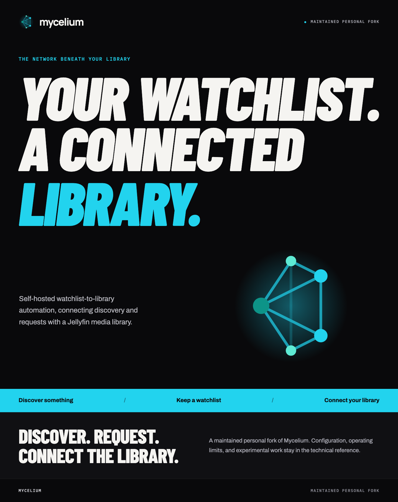
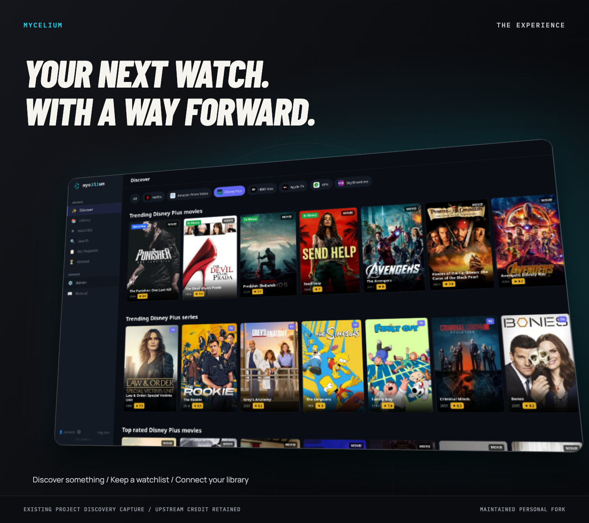
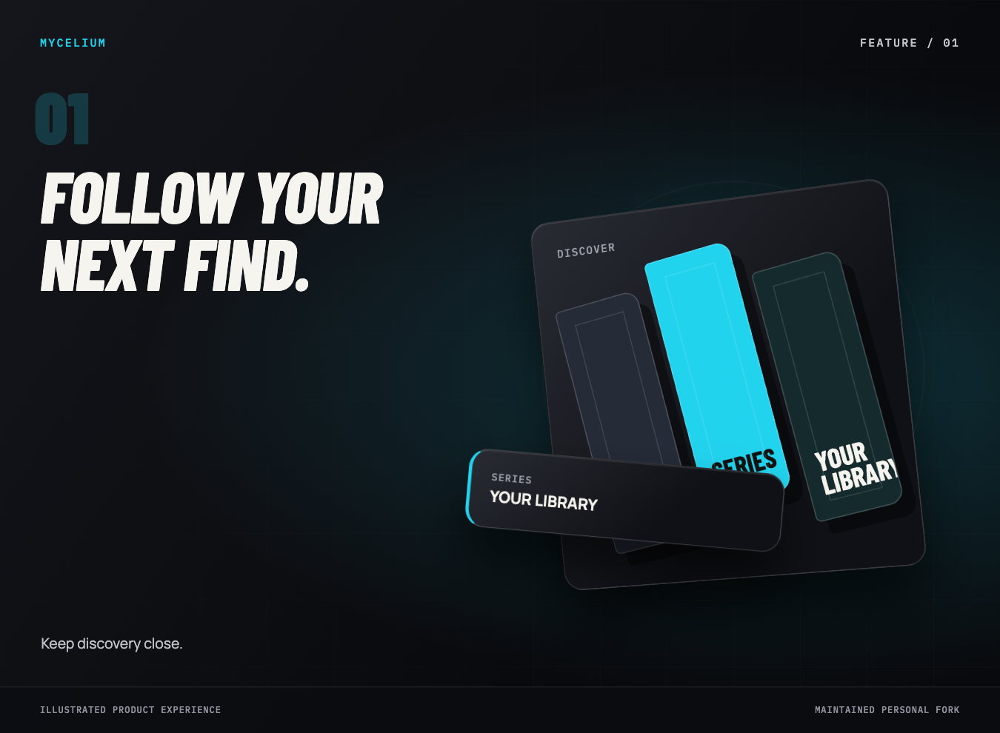
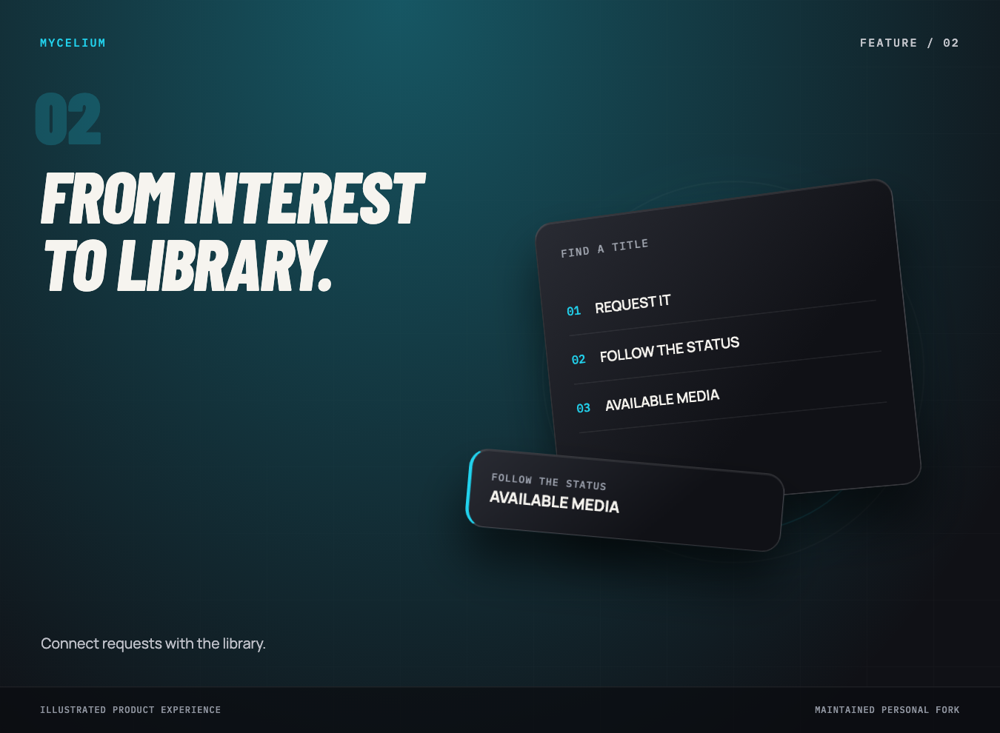
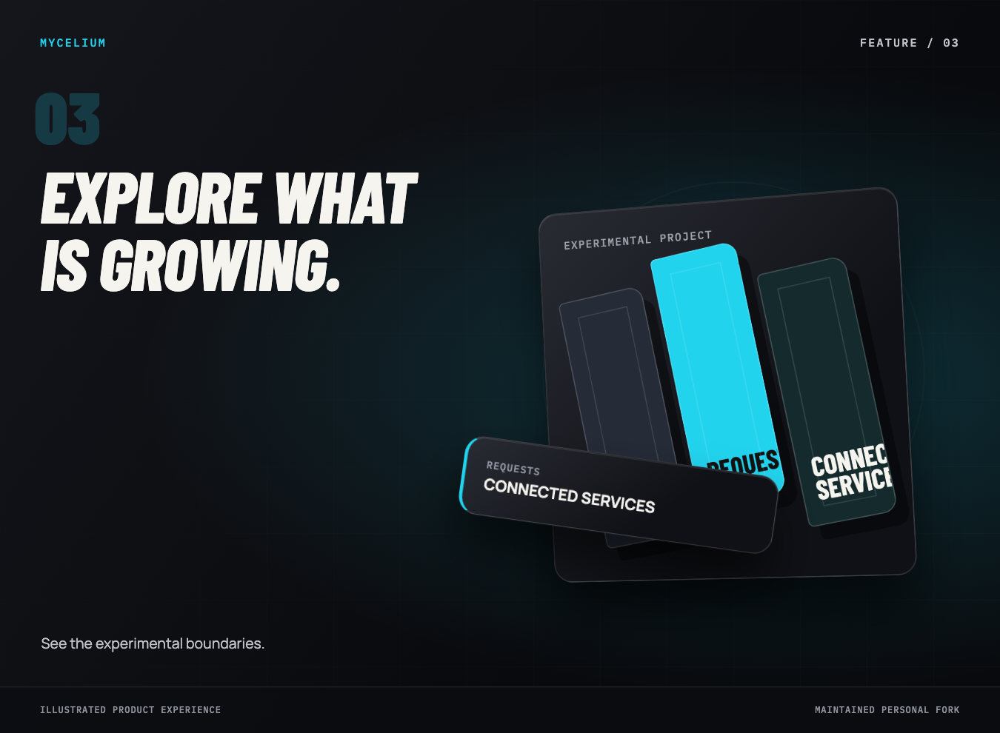
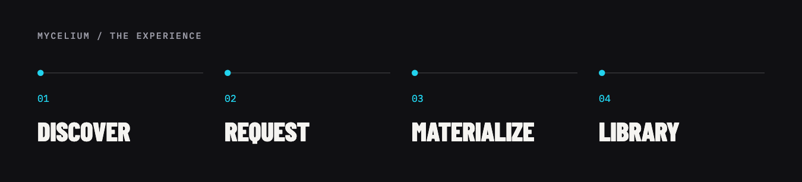
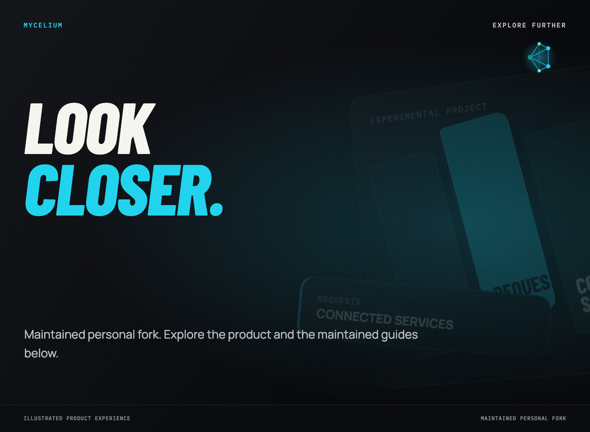

# mycelium

Self-hosted watchlist-to-library automation, connecting discovery and requests with a Jellyfin media library.

**Maintained personal fork.**

[Upstream project](https://github.com/corveck79/mycelium) · [Documentation](docs/) · [Changelog](CHANGELOG.md) · [License](LICENSE) · [Technical reference](DEVELOPMENT.md)

## The network beneath the library

Mycelium connects the act of discovering something to watch with the work of making it appear in a self-hosted library. The project brings discovery, watchlists, requests, provider integration, and library materialization into one workflow, with operating limits documented beside the source.

**Who it is for:** self-hosted media-library operators who want watchlists and requests to connect with a Jellyfin library. This is DMPhx’s maintained personal fork of the upstream project.

*Existing Mycelium discovery screenshot retained from the project assets.*

## What the experience brings

### Keep discovery close

The application provides discovery, search, watchlists, and request views. The point is to give the next title a place in the workflow instead of keeping suggestions in an unrelated note or chat.

### Connect requests with the library

Provider integration and the Catbox materialization flow connect selected titles with library entries. Configuration, authentication, provider limits, and failure states remain part of the operating story, rather than being hidden behind a promise that every request will be immediately playable.

### See the experimental boundaries

The fork includes additional work such as the experimental Plex Spore integration. The technical reference distinguishes normal operation, configuration, constraints, and work in progress; experimental paths are not presented as a general stable-release guarantee.

## From the first step to the next one

1. **Discover.** Find a title through discovery or search.
2. **Keep the request.** Add the title to the watchlist or request flow.
3. **Connect the library.** Let the configured workflow resolve and materialize the library entry.
4. **Follow the result.** Use the application’s views and operating documentation to understand its state.

## A suggestion with an onward path

A title someone wants to watch can move through a defined request workflow rather than being copied between unrelated tools. When a provider limit or unavailable release interrupts the path, the project’s documented states and controls give the operator somewhere to investigate.

## Availability

This is a public personal fork of corveck79/mycelium. Upstream attribution and licensing remain intact. Read the technical reference before deployment, particularly the provider limits, security configuration, and experimental features.

## Explore further

- [Documentation wiki](https://github.com/dmphx/mycelium/wiki)
- [Upstream project](https://github.com/corveck79/mycelium)
- [Documentation](docs/)
- [Changelog](CHANGELOG.md)
- [License](LICENSE)
- [Technical reference](DEVELOPMENT.md)
